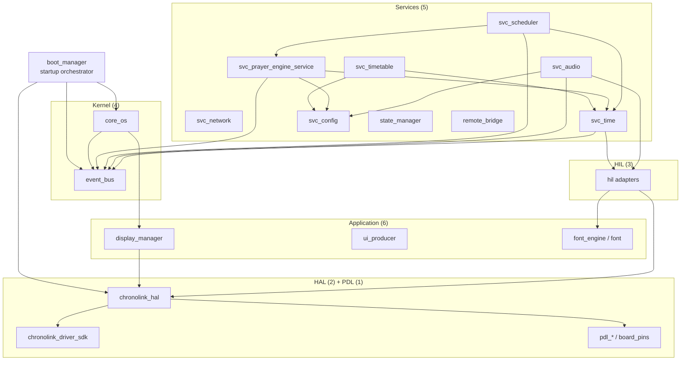
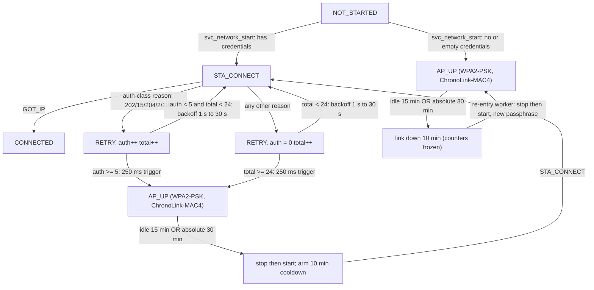

# ChronoLink V4 OS - Architecture

This is the single canonical architecture document. It supersedes the
earlier "4-layer", "6-layer" and "HDL/HIL" descriptions, which
disagreed with each other and with the code.

---

## 1. Layer model

Layers are numbered bottom-up. A layer may only call layers **below**
it, through their public headers.

| # | Layer | Components (this repo) | Role |
|---|---|---|---|
| 0 | Flash layout | `partitions.csv` (root) | Partition table, OTA slots, `/storage` FATFS |
| 1 | PDL - Platform/Board Definition | `pdl_*.h`, `board_pins.h`, `pdl_board_esp32.c` (inside `chronolink_hal`) | Pin map, board identity, capability flags, pin validation, initial pin configuration |
| 2 | HAL - Hardware Abstraction | `chronolink_hal`, `chronolink_driver_sdk` | Drivers: GPIO, I2C, SPI, RTC (DS3231M), display (router + ST7796S / MAX7219 / remote / mock / custom backends), sensors (SHT4x, BME280, VEML7700), audio (MAX98357A) |
| 3 | HIL - Hardware Independent Layer | `hil` | Thin `bool`-returning adapters over the HAL, for services (`display_api`, `rtc_api`, `sensor_api`, `audio_api`, `gpio_api`, `i2c_api`, `spi_api`) |
| 4 | Kernel | `core_os`, `event_bus` | FreeRTOS tasks, queues, event bus, safe-mode handling |
| 5 | Services | `state_manager`, `svc_network`, `svc_time`, `svc_config`, `svc_prayer_engine`, `svc_prayer_engine_service`, `svc_timetable`, `svc_scheduler`, `svc_audio`, `remote_bridge` | Logic and engines. New services use the `svc_` prefix. |
| 6 | Application | `ui_producer`, `display_manager`, `font_engine`, `font`, `main/` | UI and display logic. The app band consumes services and never calls the HAL directly (see section 5). |
| — | Managed library | `chmorgan/esp-libhelix-mp3` | Fixed-point Helix MP3 decoder, fetched by the ESP component manager (declared in `components/svc_audio/idf_component.yml`) and used only by `svc_audio`. Not a layer and not a `components/` directory: it touches no hardware. Licence: RPSL 1.0 / RCSL 1.0 on the decoder sources, Apache-2.0 on the packaging. |

`boot_manager` is **not a layer**. It is the startup orchestrator that
runs once, before the kernel's tasks exist. See [boot.md](boot.md).

PDL is not a separate component today: its headers and one `.c` file
live in `chronolink_hal` and are logically the bottom of that
component.

The legacy `src/app/*` and `src/svc/*` placeholder tree was **removed**
(CR S2, 2026-11-18). It was never compiled: `platformio.ini` sets
`src_dir = main` and nothing registered `src/` as a component, so its
removal changes no binary. Application code lives in `main/` and in the
app-band components listed above.

Service components use the `svc_` prefix. The current
component-to-layer mapping is listed in `components/README.md`.
Components predating the prefix convention (`state_manager`,
`remote_bridge`) are listed there and may be renamed in a future
cleanup PR.

---

## 2. Rules (short form)

1. Lower layers never call higher layers. No circular dependencies.
2. Services and the application use the HIL where an adapter exists.
3. Only the HAL touches hardware registers or ESP-IDF peripheral
   drivers (`driver/i2c.h`, `driver/spi_master.h`, I2S, GPIO).
4. Filesystem is FATFS on `/storage` only. No SPIFFS, no LittleFS.
5. The full rule set, including documented exceptions, is in
   [CHRONOLINK_CONSTITUTION.md](CHRONOLINK_CONSTITUTION.md).

---

## 3. Dependency diagram (as built)

---

## 4. Runtime model

- `app_main()` (`main/main.c`) calls `boot_manager_init(0)`, registers
  the built-in 8x8 font, starts `ui_producer`, starts `svc_time` (RTC +
  NTP; it must be up before anything can publish
  `EVENT_NETWORK_CONNECTED`), then starts `svc_network` (non-fatal if
  Wi-Fi fails; the clock keeps running from the RTC).
- `core_os_init()` creates the event bus and calls
  `display_manager_init()`.
- `core_os_start()` starts with a kernel-owned `event_dispatch_task`
  that drains the event bus and logs each received event at DEBUG level;
  it is created before `state_q` / `core0_task` / `core1_task` so the
  boot-stage events published around this call are not evicted from the
  32-slot queue. Subscriber fan-out (queue-forward) exists as of PR 5b-1:
  `event_bus_dispatch()` forwards matching events to registered
  subscriber queues. `svc_time` registers the first subscriber
  (`EVENT_NETWORK_CONNECTED`, PR 5b-2).
- `svc_time_start()` subscribes to `EVENT_NETWORK_CONNECTED` and runs NTP
  on its own worker task; a failed sync is retried by an `esp_timer`
  backoff (1 min -> 5 min -> 15 min -> 1 h). Only UTC is ever written to
  the RTC; local time is derived at read time from the POSIX TZ rule.
- `svc_timetable_init()` runs before the prayer service. It parses the
  year timetable from `/storage/timetable.json` into a 128 KB buffer,
  extracts today and tomorrow into RAM, and frees the buffer.
- `svc_prayer_engine_service_start()` calculates the initial times. If
  the timetable is stale or missing, it spawns a background `regen_task`
  (8 KB stack) to regenerate the 365-day file.
- `svc_scheduler_init()` / `svc_scheduler_start()` run after
  `svc_http_start()` and `svc_audio_start()`. `init()` pre-marks the prayers that already passed
  today, so a mid-day boot does not replay them; `start()` creates the
  1 Hz poll task on core 0 and subscribes it to
  `EVENT_TIME_DATE_CHANGED` and `EVENT_PRAYER_TIMES_UPDATED`. Each second
  it compares `svc_time_get_epoch()` with today's adhan epochs and
  publishes `EVENT_PRAYER_TIME_REACHED` once per prayer per day. Matching
  is by epoch only, never by `(hour, minute)`, so DST fall-back and NTP
  steps cannot double-fire. Details in `STATUS.md` (`svc_scheduler`).
- `svc_audio_start()` runs on `svc_http_start()`'s success path and
  **before** the scheduler, so the first prayer event already has a
  subscriber. One task (`svc_audio`, 6 KB stack,
  `tskIDLE_PRIORITY + 3`, core 0) owns the queue it created and
  subscribes to `EVENT_PRAYER_TIME_REACHED` through
  `event_bus_subscribe()`; it never drains the kernel queue. For an
  adhan-tier event it re-reads `adhan_mode`/`adhan_volume` from
  `svc_config`, decodes `/storage/adhan.mp3` with libhelix-mp3 (fixed
  point; heap-resident state), downmixes/scales the PCM in software and feeds
  `audio_play_pcm()`. I2S is initialised on that task when playback
  starts and deinitialised before it returns to idle, so there is no
  idle I2S channel between adhans (the boot path no longer calls
  `HAL_Audio_Init()`). The MAX98357A amplifier is handled the same way:
  `pdl_board_init()` leaves SD_MODE (GPIO1) low and
  `audio_amp_set_enabled()` releases it per playback, so the amp is in
  0.6 uA shutdown between adhans. Publishes `EVENT_AUDIO_STARTED` (98),
  `EVENT_AUDIO_COMPLETED` (99) and `EVENT_AUDIO_ERROR` (100); a missing
  asset is logged and skipped with no event. Details in `STATUS.md`
  (`svc_audio`) and `docs/audio-adhan-design.md`.
- `core_os_start()` then starts a state-queue task, a `core0_task`
  (system / network) and a `core1_task` (UI / clock). `core1_task`
  calls `display_manager_process_frame()` about every 16 ms.
- `ui_producer` runs one task on core 0 (`ui_prod`, `tskIDLE_PRIORITY + 2`,
  3072 B stack) that wakes every 250 ms, reads `svc_time_get_snapshot()`,
  and submits a clock frame through `display_manager_submit_frame()` only
  when the formatted local string changes. Each frame carries one
  `DM_CMD_DRAW_TEXT_SCALED` command for the clock string, plus (when the
  RTC is untrusted) a fill_rect and two scaled-text commands for the red
  warning banner. The first frame adds a full-screen clear; later frames
  need no per-frame erase because each scaled glyph blit paints its full
  rect including background. Rendering on change keeps the 3-slot frame
  queue from filling.

Two font formats, two panel families: `FONT_FORMAT_MONO_1BPP`
(per-pixel draw; `FONT_BUILTIN_8X8`, id 0) is the correct
representation for 1-bit panels such as MAX7219 and dot-matrix, and
`FONT_FORMAT_RGB565` (row blit via `HAL_GFX_BlitScaled`, scaled to a
panel-derived target height; `FONT_UI_SANS`, id 1, a placeholder
pending the project TTF -- Inter SemiBold, SIL OFL) serves colour
panels. The mono path is unchanged. The ST7796S backend correctly
declines text; the font layer is the sanctioned text path for both
panel families.

- **Safe mode (`BOOT_FLAG_SAFE_MODE`) is currently unreachable dead
  code** (CR S3, documented 2026-11-18). No firmware path sets the flag:
  `main.c` calls `boot_manager_init(0)`, `read_pending_boot_request()`
  can only return `BOOT_FLAG_FACTORY_RESET`, and `app_main()` never
  gates service startup on it. If the mode is ever wired up,
  `event_dispatch_task` must be started **before** the safe-mode early
  return in `core_os_start()`: `core_os_init()` already started the 1 Hz
  heartbeat timer before that check, and every service in `app_main()`
  still starts and publishes. With no dispatcher, the 32-slot event bus
  fills and the evict-oldest path silently drops events -- exactly the
  CR #1 class of bug -- while `core1_task` never runs, so submitted
  frames never render.

### 4.1 Time, Sync, and Prayer State Machine

The firmware operates on a resilient, always-on state machine that prioritizes keeping the correct time even if the network is offline. Implemented on branch `feat/time-state-machine`; see `STATUS.md` ("Phase 3 Additions") for the item-by-item status.

**Boot Sequence:**
1. `svc_time` reads the hardware RTC immediately. If valid, internal ESP32 time is set.
2. `svc_prayer_engine_service` calculates today's prayer times immediately based on the RTC time.
3. `svc_network` starts attempting to connect to Wi-Fi in the background (infinite retry).
4. If Wi-Fi connects, NTP syncs, updates the hardware RTC, and recalculates prayer times if the date shifted.

**Hourly Fallback (ESP32 Internal Clock Correction - No Wi-Fi Needed):**
- Once per clock hour — on the first `svc_time` tick of each clock hour, guarded by `s_last_hourly_correction_key = yyyymmddhh` — `svc_time` reads the hardware RTC.
- If the ESP32's internal clock has drifted from the RTC by more than **1 second**, the internal clock snaps to the RTC time via `settimeofday()`. (The DS3231M RTC is highly accurate, drifting only ~1 second per year, while the ESP32's internal oscillator drifts by seconds per day.)
- The trigger is edge-detection on the clock hour, not an exact-`XX:00:00` match, so a tick that lands a second or two late still fires exactly once. If the RTC read fails or returns an invalid timestamp, the check is skipped (logged at DEBUG) and the system clock is left unchanged.

**23:00 Daily Sync (RTC Drift Correction - Wi-Fi Needed):**
- At the first `svc_time` tick of 23:00 local time (guarded by `s_last_daily_sync_date = yyyymmdd`), `svc_time` triggers a one-shot NTP sync **if** Wi-Fi is connected, to correct the hardware RTC. Wi-Fi state is tracked from `EVENT_NETWORK_CONNECTED` / `EVENT_NETWORK_DISCONNECTED` — `svc_time` does not call `svc_network` directly (Constitution §10).
- The sync runs in a dedicated `daily_sync_task` so the 1 Hz `svc_time` worker tick keeps running during the up-to-10 s NTP block.
- If Wi-Fi is offline, the sync is skipped (no retry). If the sync fails, no backoff is scheduled — the next attempt is tomorrow at 23:00. The clock continues relying on the RTC, and the RTC relies on its own extreme accuracy until the next successful sync.

**Sync Telemetry (Last Known Good State):**
- Every time an NTP sync succeeds and the hardware RTC is updated, `svc_time` records the exact Unix Epoch timestamp (`time_t`) of that success in NVS (key `last_sync_utc`). 
- **This timestamp is strictly stored in UTC**, not local time. This ensures it remains accurate across DST shifts or timezone changes.
- If the 23:00 sync fails (no Wi-Fi, no internet, or NTP server unreachable), the system does **not** overwrite this timestamp.
- The web UI / config portal can read this timestamp via `svc_time_get_last_sync_time()`. The UI is responsible for converting this UTC timestamp to the user's local time. If the last sync was more than 24 hours ago, the UI should display a warning (e.g., "Warning: Clock has not synced in X days. Check Wi-Fi connection.").

**RTC Trust Policy (PR 5.5b):**

- `svc_time` reads the RTC even when the oscillator-stop flag (OSF) is set, so the UI has a value to display (`--:--` if untrusted).
- `svc_time_snapshot_t.rtc_untrusted` is true if OSF is set OR the RTC year is strictly less than the firmware build year (parsed from the `__DATE__` compile-time macro).
- `svc_prayer_engine_service` refuses to publish prayer times while `rtc_untrusted` is true.
- The UI shows a "Starting..." splash on boot, `--:--` for an untrusted RTC, and a two-line "Time invalid / Check internet" banner after 60 seconds (so normal WiFi+NTP boots don't flash it).
- Once NTP syncs, `rtc_untrusted` is cleared and the display switches to the clock.

**00:00 to 00:01 Midnight Rollover:**
- When the local date changes, `svc_time` publishes `EVENT_TIME_DATE_CHANGED`. The same event is also published on a DST / UTC-offset change (see `check_and_publish_date_change()` in `svc_time.c`).
- `svc_prayer_engine_service` distinguishes the two cases by comparing the cache's `tz_offset_minutes` field:
  - **Pure date rollover** — the service sets `s_date_changed_pending` on the first tick of 00:00 and recalculates on the first tick where the local clock is past 00:00. This is the intended one-minute settling window before the new day's prayer times are computed.
  - **DST / UTC-offset change** — the service recalculates immediately; no delay.
  - **Successful NTP sync** (`EVENT_TIME_UPDATE`) — recalculates immediately and clears any pending date-change deferral.

> **Living Document Note:** 
> This state machine is a continuous evolution process. As we discover more efficient, robust, or fool-proof sequences (e.g., handling extreme edge cases, optimizing power consumption, or improving network fallback), this section will be updated. 
> 
> **Workflow Rule:** Any modification to this sequence requires a dedicated Git branch (e.g., `feat/time-logic-update`), a code review, and an update to this exact document in the *same* PR. Never commit changes to this logic directly to `main`.

### 4.2 Prayer times: three-tier model

The prayer-times pipeline has three layers of user-visible time
(astronomical / adhan / jamat) plus auxiliary and Ramadan endpoints.
The full model — concepts, jamat anchors, seasonal offsets, rounding,
presets, tomorrow's jamat, and the pre-5.1a migration path — is in
[prayer-times-model.md](prayer-times-model.md). This section is only
the pointer; the domain model lives there.

**City presets (2026-11-22).** A preset is data, not an algorithm: the
nine-city `k_city_presets[]` table in `svc_config.c` maps a preset id to
latitude, longitude, POSIX timezone, method, high-latitude rule, madhab and
Hijri options. `svc_config_apply_preset()` copies those fields into the
config (seeding `location_name` only when it is empty), persists them to NVS
and never stores the preset id itself, so a preset is a one-shot seed rather
than a mode the device stays in. It deliberately does not touch `jamat[]`,
`season`, adhan offsets or display preferences, which keeps congregational
times mosque-specific. `set_defaults()` applies preset 0 (Horsham, UK), so an
NVS-erased board is location-valid at first boot. `POST /api/config/preset`
applies a preset and its timezone at runtime; `www/index.html` mirrors the
same table so the "Quick Setup: Select Your City" dropdown can fill the form
without a round trip, and the dropdown's value is an index only — nothing
about the selection is persisted. Domain detail:
[prayer-times-model.md](prayer-times-model.md) §5.

### 4.3 WiFi provisioning mode (CR #2 recovery path, unified by CR #4)

A clock whose saved Wi-Fi credentials stop working used to retry forever, with
no way back in short of a USB reflash. `svc_network` now detects a credential
lockout and raises an **in-place** provisioning AP (no reboot) that an installer
can join to correct the credentials. CR #4 unified that AP with the
first-boot/unconfigured AP: one SSID (`ChronoLink-<MAC4>`), the same WPA2-PSK
settings and the same freshly generated passphrase in both cases, so nothing
over the air reveals which scenario is running. The full design -- rejected
alternatives, review history, verification checklist -- is in
[sessions/cr2-wifi-lockout-design.md](sessions/cr2-wifi-lockout-design.md).
This section records the shape and the invariants that must survive
refactoring.

Because CR #4 gives both entry paths one identity, `SETUP` and `RECOVERY` are
the same AP on the air and in the UI. They differ in how the exit resolves, not
in whether one exists: since Setup-AP timeout parity both nodes arm the same
`arm_ap_timeout()` bounds (15 min idle / 30 min absolute), and `RECOVERY` exits
to `STA_CONNECT` with the possibly corrected credentials plus the 10 min
cooldown, while `SETUP` — which has no credentials to return to — holds the link
down for the same `SVC_NETWORK_COOLDOWN_US` (10 min, both failure counters
frozen) and is then re-entered by the `s_setup_reentry_timer` worker through
`svc_network_stop()` + `svc_network_start()` with a rotated passphrase. Calling
`svc_network_start()` directly on that exit would re-raise the AP on the spot
(the empty-SSID branch), i.e. an entry/exit loop, so re-entry is deferred to the
timer; a stray `start()` during the cooldown defers the same way. Power-cycling
clears all of it, because no recovery state is persisted.

`AP_UP` covers both "no credentials at boot" and "an empty SSID stored" -- an
empty SSID can never associate, so `svc_network_start()` treats it as
unconfigured instead of burning the STA ladder on a guaranteed failure. Both
lockout triggers share one entry helper, `arm_recovery_entry()`: the AP sits
after `RETRY` and before `CONNECTED`, is entered from `RETRY` when either
streak reaches its threshold (5 auth-class, or 24 of any reason), and returns
through `svc_network_stop()` then `svc_network_start()` to `STA_CONNECT`,
never straight to `CONNECTED`.

**Thresholds and windows.** Plain `#define`s in `svc_network.c` (the same
precedent as `SVC_NETWORK_BACKOFF_MAX_MS`), not Kconfig entries:

| Constant | Value | Meaning |
|---|---|---|
| `SVC_NETWORK_AUTH_FAIL_THRESHOLD` | 5 | consecutive auth-class failures that trigger recovery |
| `SVC_NETWORK_UNREACHABLE_FAIL_THRESHOLD` | 24 | consecutive failures of **any** reason that trigger recovery (slow path) |
| `SVC_NETWORK_RECOVERY_IDLE_WINDOW_US` | 15 min | exit after 15 min with no exempted HTTP request |
| `SVC_NETWORK_RECOVERY_ABSOLUTE_CAP_US` | 30 min | hard exit regardless of activity |
| `SVC_NETWORK_COOLDOWN_US` | 10 min | after exit, window in which auth failures are not counted; for a Setup AP exit it is also the deterministic link-down delay before re-entry |
| entry-trigger one-shot | 250 ms | delay before the entry worker is spawned |

**Reason whitelist.** Only these `WIFI_EVENT_STA_DISCONNECTED` reasons count
toward the streak:

| Reason | Name |
|---|---|
| 202 | `WIFI_REASON_AUTH_FAIL` |
| 15 | `WIFI_REASON_4WAY_HANDSHAKE_TIMEOUT` |
| 205 | `WIFI_REASON_CONNECTION_FAIL` |
| 204 | `WIFI_REASON_HANDSHAKE_TIMEOUT` |
| 2 | `WIFI_REASON_AUTH_EXPIRE` |

Every other reason resets the auth streak to 0 and reconnects as before (PR
#157: it also advances the any-reason counter described below).
`205 CONNECTION_FAIL` is in the whitelist: it is emitted when the AP was seen
but the association or handshake was rejected, which is how some routers
answer a wrong password. While it was excluded it reset the streak, so a run
that mixed `15`/`202` with `205` never reached the threshold and a pure-`205`
wrong password only ever hit the slow path.
**#131 R1 is preserved for the credentials question:** the deliberate
exclusions are `200 BEACON_TIMEOUT`, `201 NO_AP_FOUND` and
`212 NO_AP_FOUND_IN_RSSI_THRESHOLD` -- the "router is down or out of range"
signatures -- so that case is never *classified* as wrong credentials and STA
keeps being retried first, with the any-reason slow path as its bounded
backstop. `210`/`211` (WPA3-only security mismatch) are deliberately
deferred to a follow-up.

**Slow path (PR #157).** The auth streak alone left a configured clock
stranded whenever the failure was not a credential rejection: a driver that
keeps failing to come up, an AP that answers `NO_AP_FOUND` forever, or one
that is simply out of range all produced infinite STA retries with no way back
in. A second counter, `s_consecutive_fail`, now counts consecutive
`STA_DISCONNECTED` events of **any** reason under the same guard; at
`SVC_NETWORK_UNREACHABLE_FAIL_THRESHOLD` (24, roughly 10 min at the capped 30 s
backoff) it enters recovery through the same `arm_recovery_entry()`. Both
triggers therefore obey the same rules: nothing is counted while
`recovery_guards_active()` (cooldown or recovery up), the 250 ms one-shot is
the only spawn path, and `IP_EVENT_STA_GOT_IP` clears both counters.

**Cold-boot bring-up failure (PR #157).** `svc_network_start()` returning
`ESP_FAIL` from a cold boot (setup AP, or the STA `esp_wifi_set_mode` /
`_set_config` / `_start` sequence) now arms the bring-up retry ladder instead
of leaving the clock with no link and no AP. The failure path leaves the
service stoppable (`s_started = true`, the same partial-failure contract the
setup AP already used) so the retry worker's `stop()` can deinitialise the
driver before `start()` runs again; without that the retry would die on
`esp_wifi_init()`'s `ESP_ERR_WIFI_INIT_STATE` forever.

**Where the pieces live:**

- `svc_network.c` -- reason classification, the two streak counters, the
  single guarded entry helper `arm_recovery_entry()` (both triggers use it),
  the entry, exit, bring-up-retry and setup-re-entry workers, the five timers
  (entry trigger, idle/absolute timeout, bring-up retry, cooldown, setup
  re-entry), `arm_ap_timeout()` (arms the shared 15 min idle / 30 min absolute
  one-shot, called by the lockout entry worker and by `start_ap_mode()` for
  `AP_MODE_SETUP`, so both APs carry the same bounds), the bring-up retry
  ladder (1 s -> 30 s, never gives up; also armed from a cold-boot bring-up
  failure), the unified identity (`generate_ap_identity()`, `s_ap_ssid` /
  `s_ap_pass` under `s_ap_identity_lock`, called by `start_ap_mode()` for both
  `AP_MODE_SETUP` and `AP_MODE_RECOVERY`), and the accessors
  `svc_network_is_ap_mode()`, `svc_network_get_ap_ssid()`,
  `svc_network_get_ap_passphrase()`,
  `svc_network_touch_provisioning_idle_timeout()`.
- `svc_http.c` -- the static `provisioning_exempt()`, called first from
  `require_auth()`. While the provisioning AP is up it accepts
  `/api/wifi`, `/api/config`, `/api/timetable` and `/api/reboot` without the
  `X-Chronolink-Auth` token. On those paths a non-GET request (`POST`,
  `DELETE`) must also carry `Content-Type: application/json` (strict; an HTML
  `<form>` cannot produce it, so form-based CSRF stays blocked), and it then
  touches the idle timer; GET is exempt from that requirement because a GET
  must be side-effect free and browsers never attach a content-type to one.
  Every write outside that list keeps the token -- in particular `/api/ota`,
  `/api/factory-reset`, `/api/config/preset` and `/api/timetable/regenerate`
  (the last two because `uri_path_equals()` matches a full path, not a
  sub-path).
- Auth model to keep in mind while reading the two service bullets above:
  **reads are open, writes require auth.** No GET handler calls
  `require_auth()`, so `/`,
  `/api/config`, `/api/timetable`, `/api/prayers` and `/debug/ntp` answer
  without the token in every mode, not just in AP mode. The method guard in
  `provisioning_exempt()` is defensive only -- it stops a future GET handler on
  one of the four exempt paths from inheriting a content-type requirement and
  locking browsers out of reading.
- API tokens are 16 hex characters (64-bit). This is typeable in debug mode
  while providing adequate security for local admin operations: the threat
  here is a drive-by CSRF or someone on the mosque WiFi, and that network is
  already gated by its WPA2 password. The token is a check on who is asking,
  not a defence against an attacker holding the passphrase or physical
  access. A device that holds a token of any other length (the 64-char token
  an older image wrote) discards it and generates a fresh one at boot, which
  is why the length can be changed without a migration step.
- `ui_producer.c` -- one provisioning screen (SSID + passphrase), keyed on
  `svc_network_is_ap_mode()` alone. There is no second predicate any more,
  because both entry paths share one identity.

**Security invariants (must survive refactoring).** Copied verbatim from
[sessions/cr2-wifi-lockout-design.md](sessions/cr2-wifi-lockout-design.md)
section 5.

**Invariant 1 (rewritten by CR #4) — the auth exemption keys on AP mode, and
only because every provisioning AP is WPA2-PSK.**
`provisioning_exempt()` (in `svc_http.c`) branches on
`svc_network_is_ap_mode()`. That is sound *only* while both entry paths raise
the same SSID (`ChronoLink-<MAC4>`) with `WIFI_AUTH_WPA2_PSK` and a per-entry
random passphrase shown only on the device panel, so joining it proves physical
possession. Never revert an AP to `WIFI_AUTH_OPEN`, and never give the setup
path a separate (open) identity: either change makes the exemption
unauthenticated. The pre-CR #4 form of this invariant ("never key on
`is_ap_mode()`; the setup AP is open") is obsolete, and the corresponding code
comment was rewritten in the same change.

**Invariant 2 — `s_recovery_mode` cleared first, set last.**
`s_recovery_mode` is cleared inside `svc_network_stop()`, **under the AP
identity mutex (`s_ap_identity_lock`), before any teardown begins**, together
with `s_ap_ssid` / `s_ap_pass`. It is set inside `start_ap_mode()`, **under the
same mutex, only after the AP is confirmed up** (i.e. after
`esp_wifi_start()` returned `ESP_OK` and `s_ap_mode` is about to be set true).
This keeps the recovery idle timeout and the exit worker consistent at both
edges. The httpd predicate no longer depends on it: since CR #4 it keys on
`s_ap_mode`, which `stop()` clears later on purpose (the AP is still
WPA2-protected while it is being torn down).

**Invariant 3 — `s_recovery_active` must never be held across a
`svc_network_start()` call.**
`s_recovery_active` exists only to suppress the auth-failure counter during
teardown. It is set true immediately before `svc_network_stop()` and cleared
immediately after `svc_network_stop()` returns, before `svc_network_start()` is
called. If it were held across `svc_network_start()`, the first
`STA_DISCONNECTED` after start would be swallowed (E4), the reconnect timer
would never arm, and the device would sit idle forever.

**CR #4 note — why the widened exemption is safe, and what it does not cover.**
During AP mode, all commissioning endpoints are exempt from API token auth.
This is secure because the AP is WPA2-protected (proving physical presence)
and isolated from the internet. Two limits belong with that statement. First,
"writes" is load-bearing: the exemption only ever decides write traffic today,
because no GET handler calls `require_auth()` at all -- reads are open in every
mode, so `/api/config`, `/api/timetable`, `/api/prayers`, `/` and `/debug/ntp`
need neither the AP nor the token. Second, the content-type gate covers non-GET
methods only, since a GET must be side-effect free and carries no CSRF surface.
The method guard exists so those two facts cannot change by accident.

---

## 5. Known deviations from the rules

These exist in the code today. They are documented here so nobody
mistakes them for intended design. Each has an entry in
[STATUS.md](STATUS.md).

**Type** column: `Dev` = genuine deviation to be fixed. `Exc` =
accepted exception, written into the Constitution and expected to
stay.

| Type | Deviation | Where | Intended fix / rationale |
|---|---|---|---|
| Dev | Kernel calls a service (`display_manager`) | `core_os.c` | Have `display_manager` register itself with the kernel, or start it from `app_main` |
| Dev | The app band calls the HAL directly, bypassing HIL | `display_manager` calls `HAL_GFX_*` / `HAL_Display_*` | Route through a HIL graphics adapter, or formally allow the app band to use the display HAL |
| Dev | `hal_gfx` (drawing primitives) lives in the HAL | `chronolink_hal/src/hal_gfx.c` | Move to its own graphics component above the HAL |
| Exc | `boot_manager` calls `HAL_Init()` | `boot_manager.c` | Accepted exception; provisioning step only. The BOOT-pin read that used to be here was removed in `refactor/remove-boot-button` |
| Dev | HAL reads pin settings from `main/Kconfig.projbuild` | `board_pins.h` uses `CONFIG_BOARD_*` | Move the pin Kconfig into `chronolink_hal` |
| Dev | `chronolink_driver_sdk` includes HAL headers privately | its `CMakeLists.txt` | Extract shared types into a small common component |

---

## 6. How to add things

- **A new display panel** - implement a `display_backend_ops_t`, export
  `HAL_DISPLAY_<NAME>_OPS`, add a Kconfig choice and one line in
  `hal_display_select_ops()`. Details in [hal.md](hal.md) section 6.
- **A new sensor** - implement a `hal_sensor_driver_t`, add a
  capability flag in `pdl_capabilities.h`, register it in `hal_init.c`
  under that flag.
- **A new service** - new component; depend on `hil` (not
  `chronolink_hal`); talk to other services through the event bus.
      Prefix the component name with `svc_` (e.g. `svc_config`,
      `svc_prayer_engine`). See `components/README.md` for the full
      component-to-layer mapping.
- **A new HIL adapter** - a thin `bool`-returning wrapper over the HAL.
  Add hardware logic to the HAL first, then wrap it here.
